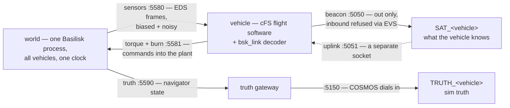

# orrery

A whole fake constellation on one laptop: realistic Basilisk digital-twin physics,
real flight software running on NASA core Flight Software (cFS), and OpenC3 COSMOS
as ground control. One scenario file is the world — every `[[spacecraft]]` block
flies its own container and its own ground services, and the shared world steps
only when every vehicle has acked. Like the clockwork it is named for: one crank,
every body at once.

## Getting started

Requirements: Linux or macOS with **Docker** and **[uv](https://docs.astral.sh/uv/)**.
No cFS source, no COSMOS checkout, no Python setup — the yard fetches and pins
those itself.

```bash
git clone https://github.com/stephen-ritter/orrery && cd orrery

scripts/fleet.sh up sim/scenarios/twin_ops.toml # everything, then 2 vehicles, one world
scripts/fleet.sh status                         # who is up, and the world's latest line
scripts/fleet.sh down                           # stop politely (digest printed at the boundary)
```

One command, cold. `compose.yml` carries the whole bootstrap as two init services
the fleet waits on, so nothing flight-side boots before the flight binary this
tree built has been compiled and stamped, and nothing Python-side boots before
the Basilisk engine and the EDS binding exist:

1. **`mission`** builds `orrery-cfs:dev`, fetches the cFS core pinned by
   `cfs_mission/cfs.lock`, builds the mission, and stamps the binary with a
   content hash of the sources it was built from. Incremental on a warm tree.
2. **`sync`** builds the Basilisk engine image, resolves `uv.lock` into the
   engine volume, and builds the EdsLib binding inside that same interpreter.

`scripts/fleet.sh` is the documented door (bare `docker compose up` works once
`ORRERY_UID`/`ORRERY_GID` are exported, but skips `fleet.sh`'s laws — see
[The fleet](#the-fleet)). `scripts/mission_build.sh` is the standalone build for
when you have edited flight software and want the receipt on its own.

Want ground control too (optional; the yard flies without it):

```bash
scripts/cosmos_stack.sh    # fetches COSMOS to the cosmos.lock pin, starts it,
                           # installs the orrery plugin — then http://localhost:2900
```

Adding a vehicle means editing two places — the scenario block and a service
pair in `compose.yml`; `docs/adding_a_spacecraft.md` walks through it.

## What flies today

Every line here is a row in the acceptance ladder, not a claim:
`bash scripts/verify.sh` flies them all, offline mirrors through live fleet.

**One scenario file, N vehicles.** Each `[[spacecraft]]` block gets its own
container, lockstep gate, port block, and COSMOS targets — all derived from the
block, never declared twice. A perpetual run (`DURATION=inf`) stops politely at
a tick boundary and prints its digest.

**Real flight software, in closed loop.** Attitude control with a supervisor
that trips, refuses, and recovers on a live bus; a burn door that vetoes
nonsense and overlapping asks before anything reaches the plant; stored
sequences (`sps`) that execute on the sim's own clock — the satellite carrying
out the future without further contact.

**Authority that can run out.** Thruster sets allocate force per tick and a
clipped tick is counted, truth-visible. A declared fuel tank drains natively as
the nozzles fire, and the world prices every tick before writing it — squeezing
asks the stock cannot cover, then starving whole ticks at exactly zero. The
published exhibit: a craft claiming 327 N·s while the world applied 49.1 and
the tank sat at `0.0` kg — because the craft is fuel-blind by design (no
sensor, no fuel claim, nothing to lie about).

**Transfers a tank can budget.** A Hohmann transfer composed ground-side from
plain per-burn asks: leg 1 full authority, the second leg fired at the apoapsis
*measured* on the truth stream (nothing predicted), and the verdict is the
orbit itself — eccentricity collapsing from 3.0e-3 to 1.4e-4, confirmed
circular by a 240 s coast. An over-priced third ask meets the dry door again,
and the fuel shortfall stays visible in the orbit, not just the ledgers.
There is no DO_HOHMANN command, on purpose: primitives fly, procedures compose.

**Two ledgers, one mission.** The craft claims what it forwarded (HK and
beacon); the world applies what physics delivered (the truth stream). They are
allowed to diverge — every bench measures the gap rather than hiding it — and
the sim is the only place both books meet.

**Cameras across the airgap.** A commanded eye lands on both views; image
files cross byte-identical; the ground names a file from the store's own
manifest and receives it, with the link healing without a bounce — all while
the trajectory digests refuse to move.

**Knowledge beside truth.** A modelled receiver and star tracker publish their
own opinions (`NavState`, `AttitudeState`) next to the truth stream; acceptance
asserts the pair must *differ* at device scale and *agree* as one world,
bounded by the sigmas the scenario file itself declares.

**The boot handshake.** Every tick, the vehicle compares three views of its
fit — what the scenario claims, what the binary was built with, what the bus
actually streams — and names the disagreement; a schema mismatch stops the
mission rather than decoding bytes under the wrong layout.

**Bit-exact determinism.** Pinned trajectory digests in `tests/baselines/` are
re-flown by the ladder; a scheduled flight repeats itself and *disagrees* with
its reactive twin on purpose; the yard refuses to boot firmware its own build
did not stamp.

## The world and the wire

**Truth never flows through cFS.** Sim truth reaches the ground over its own
per-vehicle path — world → truth gateway (`sim/truth_gateway.py`) → COSMOS
target `TRUTH_<vehicle>`. The satellite's own knowledge — noisy sensors →
`bsk_link` → cFS bus → flight software → telemetry → `gs_tcp` → COSMOS — is
`SAT_<vehicle>`. Anyone reading the station can tell which side of the sensor
model they are looking at, and the beacon socket is outbound-only: inbound
bytes are counted and refused over EVS, so a station wired to the beacon
physically cannot inject. `docs/data_provenance.md` is the full account.

One box, one wire plan; port numbers are vehicle slot 0 (`chief`), each block
derived from its scenario position.

| Port | Side | What |
| --- | --- | --- |
| `5050` | TCP (cFS → ground) | `gs_tcp` **beacon**: CCSDS telemetry out only; inbound bytes are counted and refused via EVS |
| `5051` | TCP (ground → cFS) | `gs_tcp` **uplink**: CCSDS commands in, never answered |
| `5580` | ZMQ PUB (sim → cFS) | Basilisk sensor frames (EDS-encoded, onboard view: biased + noisy) |
| `5581` | ZMQ PULL (cFS → sim) | actuator commands into the plant — `fcs` wheel torques and the per-tick burn frames, via `bsk_link` |
| `5590` | ZMQ PUB (sim → ground) | truth state → truth gateway → `TRUTH_<vehicle>`, never through cFS |
| `5591` | ZMQ PUB (sim) | echo of the torque the effector ACTUALLY felt, frame-matched (lockstep ground proof) |
| `5150` | TCP (ground) | truth gateway server: COSMOS's truth interface dials *in*; telemetry-only, truth uplink refused |
| `2900` | HTTP | COSMOS CE web + JSON-RPC API |



Every world tick checks on an ack from every vehicle (lockstep), so the diagram
is a loop the whole fleet turns together, not a pipeline. The tick's rate is the
scenario's `[simulation.dt] fsw` — the same number that sets the Basilisk
fswTask rate, read from the TOML.

## The fleet

The scenario file IS the fleet: block index is the port slot (block 0 = the
legacy set), the block name is the COSMOS target (`SAT_<NAME>`, `TRUTH_<NAME>`),
and one Basilisk world steps only when every container has acked.

```bash
scripts/fleet.sh up sim/scenarios/twin_ops.toml    # 2 vehicles, one shared world
DURATION=inf scripts/fleet.sh up sim/scenarios/twin_ops.toml  # perpetual: turns until `down`
scripts/fleet.sh status sim/scenarios/twin_ops.toml
scripts/fleet.sh down
```

`fleet.sh up` keeps laws a raw `compose up` would skip: ports derived from the
scenario, a boot-proof wait (each vehicle's own line naming its own beacon and
uplink, not a fixed sleep), a provenance check of the binary that flew, a
pre-launch sweep of stale containers and evidence — and a stop delivered at a
tick boundary so a perpetual run still prints its digest.

## Parts, not wiring

The scenario file is the **vehicle manifest**: a `[[spacecraft.sensors]]` block
picks a part, and the parts catalogue (`registry/parts.toml`) says what that
part means in flight software and on the ground — its airgap topic, EDS
container, MsgId, its EVS voice, and the acceptance exhibit it must arrive
with. Fitting a registered part is a manifest edit: the topicids header, the
frame table, the beacon table, the COSMOS defs, and the truth-vs-flight exhibit
all arrive by generation, with zero C edits (one superset firmware; presence is
runtime data). `docs/adding_a_sensor.md` is the procedure and the honest account
of what remains hand-authored and why.

## Layout

| Path | What |
| --- | --- |
| `sim/` | the Basilisk plants and the shared lockstep rig: `forge_scenario.py` builds plants from `scenarios/*.toml` (`twin_ops.toml` the fleet, `chief.toml` the operations plant, `burn.toml` / `fuel.toml` / `hohmann.toml` the authority benches), `lockstep.py` the barrier/clock/link gate, `truth_gateway.py` the per-vehicle truth server |
| `cfs_mission/` | cFS mission layer — our apps (`fcs`, `bsk_link`, `gs_tcp`, `sps`, …) and defs, grafted onto the core at configure time; the core is fetched to `cfs_mission/cfs.lock`'s pin, never vendored |
| `registry/` | `parts.toml` — the parts catalogue; `coverage.toml` — the ledger of what is supported, refused, and unwired |
| `docs/` | `adding_a_scenario.md`, `adding_a_sensor.md`, `adding_a_spacecraft.md` — the three ways to extend; `data_provenance.md` — the truth/knowledge boundary; `coverage.md` — generated from the ledger |
| `edslink/` + `codegen/` | the mission EDS compiled to a runtime schema, and the generators that derive COSMOS defs, bus tables, and every identity surface a registered part claims from it |
| `cosmos_plugin/` | the OpenC3 plugin: `SAT_<vehicle>` and `TRUTH_<vehicle>` targets, screens, and interfaces |
| `scripts/` | `fleet.sh` (the door), `cosmos_stack.sh`, `verify.sh` (the acceptance ladder), and one `check_*.sh` per live bench |
| `tests/` | the offline half of the ladder: units, wire pins, codegen idempotence, pinned trajectory baselines |
| `docker/` | the yard's two image recipes, built by the init services or `scripts/image.sh` |
