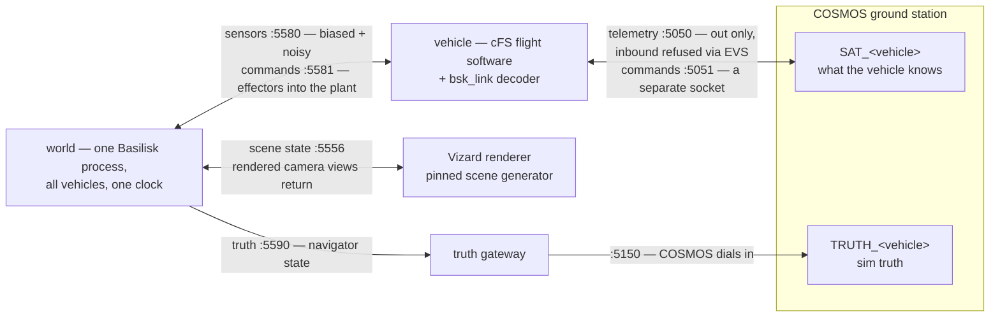

# orrery

orrery runs a complete mission loop on one workstation: Basilisk physics
simulating the spacecraft, flight software built on NASA core Flight Software
(cFS) running in real closed loop, OpenC3 COSMOS as the ground station, and
Vizard as the scene renderer behind what the cameras see.

A scenario file defines the mission. Each spacecraft it declares runs as its
own flight-software container with its own ground services, and the shared
simulation advances only when every vehicle has acknowledged the control tick
— one world, every vehicle on the same clock. Ports, ground-station targets,
command and telemetry definitions, and the acceptance checks that prove them
are all generated from the same definition, so the simulator, the flight
software, and the ground station can never disagree about what was built.

## Getting started

Requirements: Linux or macOS with **Docker** and **[uv](https://docs.astral.sh/uv/)**.
No cFS source, no COSMOS checkout, no Python setup — the build fetches and pins
those itself.

```bash
git clone https://github.com/stephen-ritter/orrery && cd orrery

scripts/fleet.sh up sim/scenarios/twin_ops.toml # everything, then 2 vehicles, one world
scripts/fleet.sh status                         # who is up, and the world's latest line
scripts/fleet.sh down                           # stop politely (digest printed at the boundary)
```

One command, cold. `compose.yml` carries the whole bootstrap as two init services
the fleet waits on, so nothing flight-side boots before the flight binary this
tree built has been compiled and stamped, and nothing Python-side boots before
the Basilisk engine and the EDS binding exist:

1. **`mission`** builds `orrery-cfs:dev`, fetches the cFS core pinned by
   `cfs_mission/cfs.lock`, builds the mission, and stamps the binary with a
   content hash of the sources it was built from. Incremental on a warm tree.
2. **`sync`** builds the Basilisk engine image, resolves `uv.lock` into the
   engine volume, and builds the EdsLib binding inside that same interpreter.

`scripts/fleet.sh` is the documented door (bare `docker compose up` works once
`ORRERY_UID`/`ORRERY_GID` are exported, but skips the checks `fleet.sh` performs
— see [The fleet](#the-fleet)). `scripts/mission_build.sh` is the standalone
build for when you have edited flight software and want the receipt on its own.

Want ground control too (optional; the fleet runs without it):

```bash
scripts/cosmos_stack.sh    # fetches COSMOS to the cosmos.lock pin, starts it,
                           # installs the orrery plugin — then http://localhost:2900
```

Adding a vehicle means editing two places — the scenario block and a service
pair in `compose.yml`; `docs/adding_a_spacecraft.md` walks through it.

## Capabilities

Every capability below is proven by the acceptance ladder:
`bash scripts/verify.sh` runs the offline checks and the live benches.

**Vehicle fleet from one scenario.** Each `[[spacecraft]]` block gets its own
container, lockstep gate, port block, and COSMOS targets — all derived from the
block, never declared twice. A perpetual run (`DURATION=inf`) stops on request
at a tick boundary and prints its trajectory digest.

**Closed-loop flight software.** Attitude control with a supervisor that
detects faults, refuses invalid commands, and recovers on a live bus. Burn
requests are validated before execution — malformed asks and overlapping burns
are rejected before anything reaches the simulation. Stored sequences (`sps`)
hold commands with execution times and run them aboard on the simulation
clock, with no further ground contact.

**Fuel-limited thrust authority.** Thrusters allocate force per control tick,
and a tick the hardware cannot fully deliver is counted and visible in truth.
A declared fuel tank drains natively as the thrusters fire, and the simulation
prices every tick before applying it — reducing asks the remaining stock
cannot cover and withholding ticks entirely once the tank is empty, to exactly
zero. The spacecraft itself carries no fuel sensor and makes no fuel claim;
fuel is reported only on the simulation's truth stream.

**Orbital transfers.** Hohmann transfers are flown ground-side as a sequence
of the same burn commands an operator sends: an initial burn raises the
apoapsis, the second burn fires at the apoapsis detected from the truth
stream, and the result is verified from the orbit itself — eccentricity
collapsing, radius holding steady on a confirmation coast. The deliberate
absence of a dedicated transfer command is the design: flight software
executes primitives, and the ground composes them into maneuvers.

**Separate craft and world telemetry.** The spacecraft's telemetry reports
what it commanded; the truth stream reports what the simulation applied. The
two are distinct packets on distinct wires by construction, divergence between
them is expected under fuel exhaustion or hardware saturation, and the sim is
the only place both are visible.

**Camera operations across the airgap.** A pinned Vizard renderer (verified
against `vizard.lock`) generates each camera's view of the scene; limb and
horizon estimators turn those pixels into planet vectors, so what the bus
carries is knowledge, never image bytes. Pointing commands land on both the
vehicle's view and the station's views; recorded image files cross to the
ground byte-identical; the ground selects a file by name from the onboard
store's manifest and receives it, recovering from link interruptions without
restarting the transfer — with the trajectory digests unchanged throughout.

**Onboard knowledge beside simulated truth.** A modelled receiver and a
modelled star tracker publish independent estimates (`NavState`,
`AttitudeState`) alongside the truth stream; the acceptance checks require
them to differ from truth at sensor scale and to agree within the uncertainties
the scenario declares — so onboard knowledge is exercised as knowledge, not
as a copy of the truth.

**Boot-time configuration handshake.** Each control tick, the vehicle compares
its scenario's declared configuration, the firmware's build-time registry, and
the data actually streaming on the bus, and reports any disagreement. A schema
mismatch halts the mission rather than decoding bytes under the wrong layout.

**Deterministic regression.** Pinned trajectory digests in `tests/baselines/`
are re-flown by the acceptance ladder, a scheduled flight repeats bit-exactly,
and the launch refuses to boot firmware its own build did not stamp.

## Data paths and ports

**Truth never flows through cFS.** Sim truth reaches the ground over its own
per-vehicle path — world → truth gateway (`sim/truth_gateway.py`) → COSMOS
target `TRUTH_<vehicle>`. The satellite's own knowledge — noisy sensors →
`bsk_link` → cFS bus → flight software → telemetry → `gs_tcp` → COSMOS — is
`SAT_<vehicle>`. Anyone reading the station can tell which side of the sensor
model they are looking at, and the telemetry socket is outbound-only: inbound
bytes are counted and refused over EVS, so a station wired to telemetry
physically cannot inject. `docs/data_provenance.md` is the full account.

One box, one wire plan; port numbers are vehicle slot 0 (`chief`), each block
derived from its scenario position.

| Port | Side | What |
| --- | --- | --- |
| `5050` | TCP (cFS → ground) | `gs_tcp` **telemetry**: CCSDS telemetry out only; inbound bytes are counted and refused via EVS |
| `5051` | TCP (ground → cFS) | `gs_tcp` **command**: CCSDS commands in, never answered |
| `5580` | ZMQ PUB (sim → cFS) | Basilisk sensor frames (EDS-encoded, onboard view: biased + noisy) |
| `5581` | ZMQ PULL (cFS → sim) | effector commands into the plant (`bsk_link`): wheel torques, burn quotas, and whatever the actuator registry gains next |
| `5590` | ZMQ PUB (sim → ground) | truth state → truth gateway → `TRUTH_<vehicle>`, never through cFS |
| `5591` | ZMQ PUB (sim) | echo of the torque the effector actually applied, frame-matched (lockstep ground proof) |
| `5150` | TCP (ground) | truth gateway server: COSMOS's truth interface dials in; telemetry-only, inbound refused |
| `5556` | TCP (sim ↔ renderer) | Vizard scene interface: the pinned renderer dials the world, receives scene state, returns rendered camera views |
| `2900` | HTTP | COSMOS CE web + JSON-RPC API |



Every world tick checks on an ack from every vehicle (lockstep), so the diagram
is a loop the whole fleet turns together, not a pipeline. The tick's rate is the
scenario's `[simulation.dt] fsw` — the same number that sets the Basilisk
fswTask rate, read from the scenario file.

## The fleet

The scenario file defines the fleet: block index is the port slot (block 0 uses
the legacy range), the block name is the COSMOS target (`SAT_<NAME>`,
`TRUTH_<NAME>`), and one Basilisk world steps only when every container has
acked.

```bash
scripts/fleet.sh up sim/scenarios/twin_ops.toml    # 2 vehicles, one shared world
DURATION=inf scripts/fleet.sh up sim/scenarios/twin_ops.toml  # runs until stopped
scripts/fleet.sh status sim/scenarios/twin_ops.toml
scripts/fleet.sh down
```

`fleet.sh up` performs checks a bare `compose up` skips: ports derived from the
scenario, a boot-proof wait (each vehicle's own startup line naming its own
telemetry and command ports, not a fixed sleep), a provenance check of the binary that
flew, a pre-launch sweep of stale containers and evidence — and a stop
delivered at a tick boundary so a perpetual run still prints its digest.

## Component registry

The scenario file is the **vehicle manifest**: a `[[spacecraft.sensors]]` block
picks a component, and the component registry (`registry/parts.toml`) defines
what that component means in flight software and on the ground — its airgap
topic, EDS container, MsgId, its EVS events, and the acceptance check it must
pass. Adding a registered component is therefore a manifest edit: the topicids
header, the frame table, the telemetry table, the COSMOS defs, and the
truth-vs-flight check all arrive by generation, with zero C edits (one superset
firmware; presence is runtime data). `docs/adding_a_sensor.md` is the procedure
and the honest account of what remains hand-authored and why.

## Layout

| Path | What |
| --- | --- |
| `sim/` | the Basilisk plants and the shared lockstep rig: `forge_scenario.py` builds plants from `scenarios/*.toml` (`twin_ops.toml` the fleet, `chief.toml` the operations plant, `burn.toml` / `fuel.toml` / `hohmann.toml` the authority benches), `lockstep.py` the barrier/clock/link gate, `truth_gateway.py` the per-vehicle truth server |
| `cfs_mission/` | cFS mission layer — our apps (`fcs`, `bsk_link`, `gs_tcp`, `sps`, …) and defs, grafted onto the core at configure time; the core is fetched to `cfs_mission/cfs.lock`'s pin, never vendored |
| `registry/` | `parts.toml` — the component registry; `coverage.toml` — the ledger of what is supported, refused, and unwired |
| `docs/` | `adding_a_scenario.md`, `adding_a_sensor.md`, `adding_a_spacecraft.md` — the three ways to extend; `data_provenance.md` — the truth/knowledge boundary; `coverage.md` — generated from the ledger |
| `edslink/` + `codegen/` | the mission EDS compiled to a runtime schema, and the generators that derive COSMOS defs, bus tables, and every identity surface a registered part claims from it |
| `cosmos_plugin/` | the OpenC3 plugin: `SAT_<vehicle>` and `TRUTH_<vehicle>` targets, screens, and interfaces |
| `scripts/` | `fleet.sh` (the standard entry point), `cosmos_stack.sh`, `verify.sh` (the acceptance ladder), and one `check_*.sh` per live bench |
| `tests/` | the offline half of the ladder: units, wire pins, codegen idempotence, pinned trajectory baselines |
| `docker/` | the two image recipes, built by the init services or `scripts/image.sh` |
