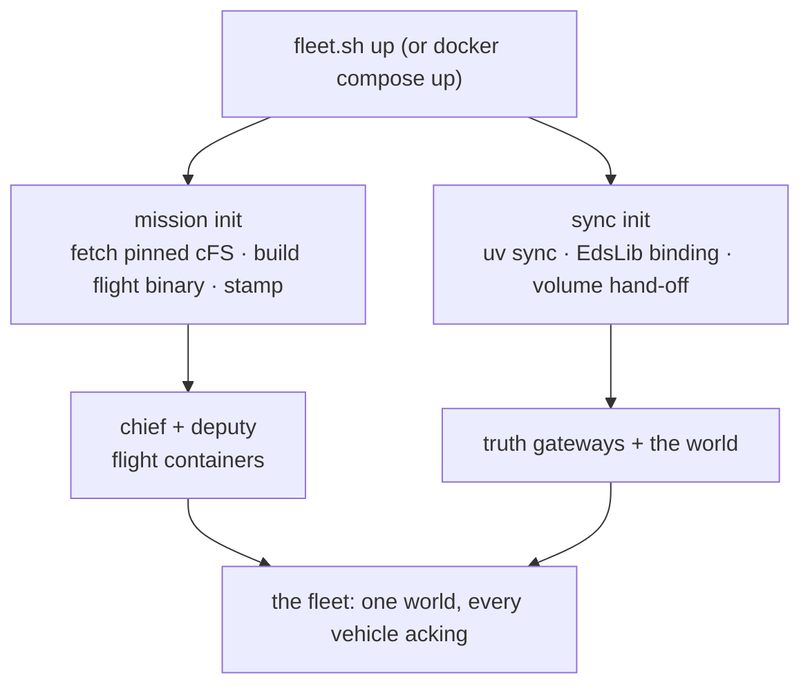
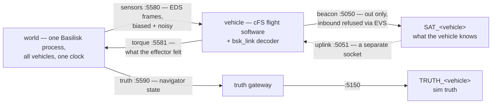

# orrery

A whole fake constellation on one laptop: realistic Basilisk digital-twin physics,
real flight software running on NASA core Flight Software (cFS), and OpenC3 COSMOS
as ground control. One scenario file is the world — every `[[spacecraft]]` block
flies its own container and its own ground services, and the shared world steps
only when every vehicle has acked. Like the clockwork it is named for: one crank,
every body at once.

## Getting started

Requirements: Linux or macOS with **Docker** and **[uv](https://docs.astral.sh/uv/)**.
No cFS source, no COSMOS checkout, no Python setup — the yard fetches and pins
those itself.

```bash
git clone https://github.com/stephen-ritter/orrery && cd orrery

scripts/fleet.sh up sim/scenarios/twin_ops.toml # everything, then 2 vehicles, one world
scripts/fleet.sh status                         # who is up, and the world's latest line
scripts/fleet.sh down                           # stop politely (digest printed at the boundary)
```

One command, cold. `compose.yml` carries the whole bootstrap as two init
services that the fleet waits on:

1. **`mission`** builds `orrery-cfs:dev` from `docker/cfs.Dockerfile` (compose
   builds an image when its tag is absent), fetches the cFS core pinned by
   `cfs_mission/cfs.lock` into `cfs_mission/cFS/` (which git never sees),
   builds the mission, and stamps the binary with a content hash of the
   sources it was built from. Incremental: on a warm tree it costs seconds.
2. **`sync`** builds the Basilisk engine image, resolves `uv.lock` into the
   engine volume, and builds the EdsLib binding inside that same interpreter.




Nothing flight-side boots before `mission` exits 0, nothing Python-side
before `sync` does — the fleet inherits exactly what this tree built.

Want ground control too (optional; the yard flies without it):

```bash
scripts/cosmos_stack.sh    # fetches COSMOS to the cosmos.lock pin, starts it,
                           # installs the orrery plugin — then http://localhost:2900
```

### Is this just `docker compose up`?

Yes, since the cold start moved into the document — with two honest caveats:

- export `ORRERY_UID`/`ORRERY_GID` to your ids first (`fleet.sh` does it for
  you): the init services build into this checkout, and bare root builds leave
  root-owned outputs;
- `fleet.sh` is still the documented door, because `up` alone skips its laws:
  ports **derived from the scenario** (block index = slot, so `--port-base`
  and single-vehicle scenarios just work), a **boot-proof wait** (each
  vehicle's line naming its own beacon/uplink pair, not a fixed sleep), a
  **provenance check** of the binary that flew, a pre-launch **sweep** of
  stale containers and evidence, and a world stopped at a tick boundary so a
  perpetual run still prints its digest.

`scripts/mission_build.sh` still exists — the standalone build for when you
have edited flight software and want the receipt on its own.

Adding a vehicle means editing two places — the scenario block and a service
pair in `compose.yml`: `docs/adding_a_spacecraft.md` walks through it.

## Layout

| Path | What |
| --- | --- |
| `docs/adding_a_sensor.md` | how hardware gets from a schema type to a flight packet — start here if you are adding a part |
| `docs/adding_a_spacecraft.md` | how to add a vehicle: a scenario block plus a service pair in `compose.yml` |
| `docs/coverage.md` | what this project supports, refuses, and has not wired yet; generated from `registry/coverage.toml` |
| `docs/data_provenance.md` | the truth/knowledge boundary: which wire is which, and why truth never reaches the flight software |
| `scripts/verify.sh` | the acceptance ladder — mirrors, builds and live fleet checks in one command |
| `sim/` | Basilisk plants + the shared lockstep rig: `lockstep.py` (barrier/clock/link gate — one world step checks on every vehicle's ack), `detumble_scenario.py` (hand-written rigid body), `forge_scenario.py` + `scenarios/*.toml` (bskforge-built plants; `detumble_forge.toml` is the frozen parity witness, `chief.toml` the wheeled + sensed operations plant, `twin_ops.toml` the two-vehicle fleet). Biased + noisy onboard sensors, EDS link frames, separate truth stream |
| `cfs_mission/` | cFS mission layer — our apps and defs, grafted onto the core at configure time. The core itself is fetched, never vendored: `cfs_mission/cfs.lock` pins it (cFS v7.0.1) and `scripts/fetch_cfs.sh` fills in `cfs_mission/cFS/`, which git never sees |
| `edslink/` | the mission EDS compiled to a runtime schema (EdsLib database + CPython binding): the Python side encodes with it and `bsk_link.so` links it in to decode with |
| `codegen/` | `eds2cosmos` + `eds_sources` + `emit_frames` — generate COSMOS cmd/tlm, the gs_tcp MsgId table, and every identity surface a registered part claims |
| `registry/` | `parts.toml` — the parts catalogue: per part its bskforge type, airgap topic, EDS container, bus identity, EVS voice, and the acceptance exhibit it must arrive with. `coverage.toml` — the ledger the coverage page is rendered from |
| `cosmos_plugin/` | OpenC3 plugin: `SAT_<vehicle>` (what the vehicle knows) and `TRUTH_<vehicle>` (sim truth) targets |
| `docker/` | the yard's two image recipes (`cfs.Dockerfile`, `basilisk.Dockerfile`), built by `scripts/image.sh` |

## The two-target rule

**Truth never flows through cFS.** Sim truth reaches COSMOS over its own
per-vehicle interface, forwarded by the truth gateway (`sim/truth_gateway.py`,
target `TRUTH_<vehicle>`). The satellite's own knowledge (noisy sensors →
`bsk_link` → cFS bus → FSW → telemetry → `gs_tcp` → COSMOS) is `SAT_<vehicle>`.
Anyone reading COSMOS can tell which side of the sensor model they are looking at.

## Ports

One box, one wire plan. The command path and the beacon are **separate sockets**
— the truth boundary is port-enforced, so a station wired to the beacon
physically cannot inject.

| Port | Side | What |
| --- | --- | --- |
| `5050` | TCP (cFS → ground) | `gs_tcp` **beacon**: CCSDS telemetry out only; inbound bytes are counted and refused via EVS |
| `5051` | TCP (ground → cFS) | `gs_tcp` **uplink**: CCSDS commands in, never answered |
| `5580` | ZMQ PUB (sim → cFS) | Basilisk sensor frames (EDS-encoded, onboard view: biased + noisy) |
| `5581` | ZMQ PULL (cFS → sim) | actuator commands back into the sim — live: `fcs` torque via `bsk_link` |
| `5590` | ZMQ PUB (sim → ground) | truth state → truth gateway → `TRUTH_<vehicle>`, never through cFS |
| `5591` | ZMQ PUB (sim) | echo of the torque the effector ACTUALLY felt, frame-matched (lockstep ground proof) |
| `2900` | HTTP | COSMOS CE web + JSON-RPC API |




Every world tick checks on an ack from every vehicle (lockstep), so the
diagram is a loop the whole fleet turns together, not a pipeline. The tick's
rate is the scenario's `[simulation.dt] fsw` — the same number that sets the
Basilisk fswTask rate, read from the TOML, overridable only by an exactly
matching flag. Port numbers shown are slot 0 (`chief`); each vehicle derives
its own block from its scenario position.

## The fleet

The scenario file IS the fleet: every `[[spacecraft]]` block is one vehicle with
its own cFS container, its own lockstep gate, and its own port block — nothing
hand-declared. Block index is the port slot (block 0 = the legacy set), the
block name is the COSMOS target (`SAT_<NAME>`, `TRUTH_<NAME>`), and one Basilisk
world steps only when every container has acked.

```bash
scripts/fleet.sh up sim/scenarios/twin_ops.toml    # 2 vehicles, one shared world
DURATION=inf scripts/fleet.sh up sim/scenarios/twin_ops.toml  # perpetual: turns until `down`
scripts/fleet.sh status sim/scenarios/twin_ops.toml
scripts/fleet.sh down
```

A perpetual run stops politely: `down` sends SIGTERM, the world finishes its
in-flight tick with every ack in place, prints its digest-so-far, exits 0.

## Parts, not wiring

The scenario file is the **vehicle manifest**: a `[[spacecraft.sensors]]` block
picks a part, and the parts catalogue (`registry/parts.toml`) says what that part
means in flight software and on the ground — its airgap topic, EDS container,
MsgId, its EVS voice, and the acceptance exhibit it has to arrive with. Fitting a
registered part is therefore a manifest edit: the topicids header, the frame
table, the beacon table, the COSMOS defs, and the truth-vs-flight exhibit all
arrive by generation, with zero C edits (one superset firmware; presence is
runtime data). `docs/adding_a_sensor.md` is the procedure, and the honest account
of what remains hand-authored and why; `scripts/check_part_landing.sh` flies the claim.

## What flies today

- **One scenario file, N vehicles.** Each block gets its own container, check, port
  block and COSMOS targets, all derived from the block rather than declared twice.
- **Real flight software, in closed loop.** `fcs` torque commands reach the plant
  through `bsk_link`; the supervisor trips, refuses and recovers on a live bus;
  `sps` executes stored command sequences on-board time — the satellite carrying
  out the future without further contact.
- **Parts by declaration.** Topic, MsgId, beacon slot, ground defs and the
  truth-vs-flight exhibit for a registered part arrive by generation.
- **Knowledge beside truth.** A modelled receiver and a modelled star tracker
  publish their own opinions (`NavState` 0x08CF, `AttitudeState` 0x08D0) next to
  the truth stream; acceptance asserts the pair must *differ* at device scale and
  *agree* as one world, bounded by the sigmas the fleet file itself declares.
- **The boot handshake.** Every tick, the vehicle compares three views of its fit
  — what the fleet file claims, what the binary was built with, what the bus
  actually streams — and names the disagreement; a schema mismatch stops the
  mission rather than decoding bytes under the wrong layout.
- **Digests, re-checked bit-exactly.** Pinned trajectory baselines in
  `tests/baselines/` are re-flown by the check ladder, and the yard refuses to boot
  firmware its own build did not stamp.
- **Ground stations** for every vehicle at `http://localhost:2900`, flight and
  truth targets per vehicle, perpetual runs that stop politely.

Everything above is a check, not a claim: `bash scripts/verify.sh` flies the ladder
that proves it, from the offline mirrors through the live fleet.
